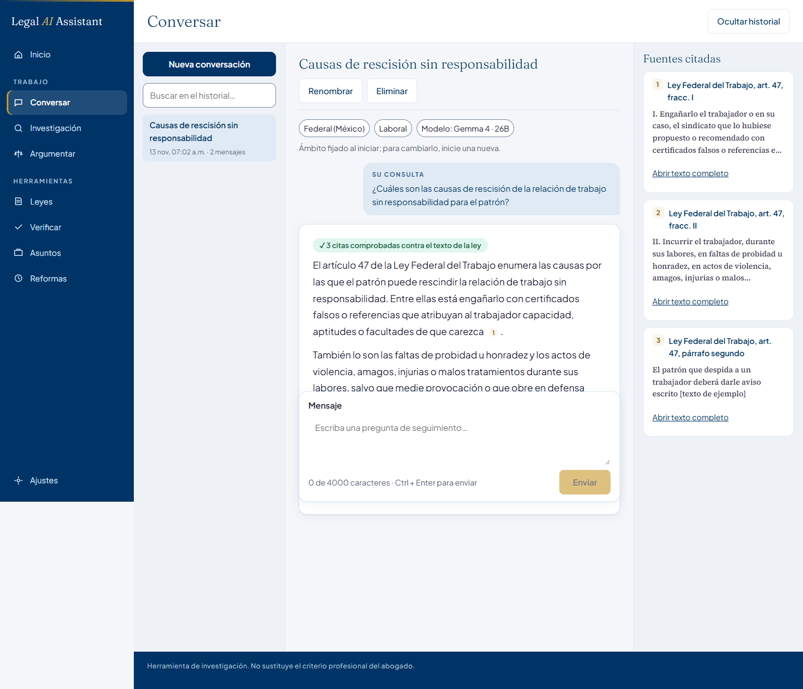
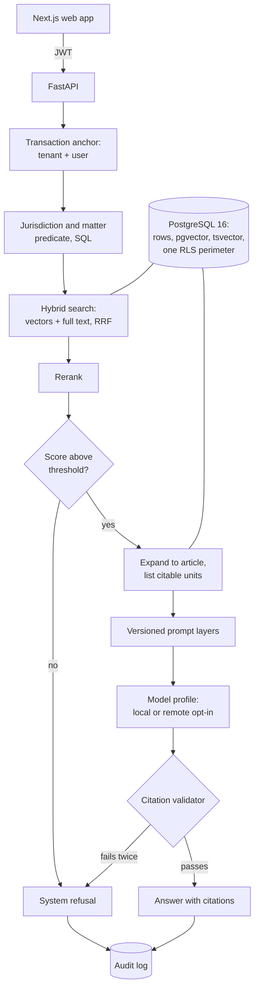

# Legal AI Assistant

[](https://github.com/OctavioPB/Legal_AI_Assistant/actions/workflows/ci.yml)
[](https://github.com/OctavioPB/Legal_AI_Assistant/actions/workflows/etl-canary.yml)

A legal research assistant for law firms in Mexico and the United States that is built so it
cannot assert law it did not retrieve. Every legal claim in an answer carries a citation that
code has checked against the retrieved text. When the sources do not support an answer, the
system refuses, and the refusal is written by the system, not by the model.

It is multi-tenant (one database, isolation enforced by PostgreSQL row-level security),
bilingual (es-MX / en-US), and the demo runs entirely on one machine with local models.



*Interface capture with sample data. Each numbered citation opens the source with the cited
passage highlighted.*

## The contract

| Rule | How it is enforced |
|---|---|
| A legal claim needs a citation to a retrieved fragment | A validator parses every `[cite: ID]` and rejects ids that were not shown to the model in this query. One regeneration, then refusal. |
| Quoted statute text must be verbatim | Quotations are compared with the cited fragment after folding accents, case and whitespace. |
| No answer without evidence | A calibrated threshold on the rerank score refuses before any model call. |
| The model never verifies itself | Refusal text, citation existence, quotation checks and coverage are code. |
| One firm never sees another firm's data | Row-level security with `FORCE`, fail-closed policies, and a test that seeds two firms with overlapping content. |
| A jurisdiction never leaks into another | A SQL pre-filter built in one function from a closed catalog. Selecting a municipality adds its state and the federation, never a sibling. |

## What a lawyer can do

- **Converse, research, argue.** Three workspaces with saved conversations: questions with
  follow-ups, a structured research file, and sparring against opposing counsel.
- **Browse the law.** Navigate each loaded statute by structure and compare versions.
- **Verify a brief.** Check every citation in a document: does the article exist, is it
  current, is the quotation verbatim. The brief is not stored.
- **Work by matter.** Conversations, notes and sources are shared with the members of a
  matter and with nobody else in the firm.
- **Use the firm's own documents.** Upload a contract, a brief or a ruling and it becomes
  citable inside its matter. The original file is not stored.
- **Follow reforms.** A scheduled job downloads official sources, loads the new version
  without deleting the old one, and flags the conversations that cite amended text.

## Architecture



The order is fixed: the predicate runs before vector search, the validator after generation.

| Decision | Reason | Record |
|---|---|---|
| One PostgreSQL holds rows, vectors and full text | A second store is a second isolation boundary to keep in sync | ADR-001 |
| Chunks follow legal structure, not token windows | The citation unit (fracción) and the context unit (article) are different on purpose | `rules/rag.md` |
| Hybrid search | "art. 123 apartado B" is a lexical signal that embeddings blur | ADR-022 |
| Refusal is a system action | Asked to decline in its own words, a model explains and then answers anyway | ADR-007 |
| The demo is fully local | Privileged material does not leave the machine | ADR-014 |
| Strict citation coverage | An uncited legal sentence does not reach the user, at the cost of some refusals | ADR-015 |

All 25 decisions, with the options considered and the measurements behind them, are in
[.claude/rules/architecture.md](.claude/rules/architecture.md). The full design is in
[docs/LegalAI-System-Architecture.md](docs/LegalAI-System-Architecture.md), which opens with
a table of where the build departs from it.

## Measured results

Golden suite, 25 cases, local models. The run records are in `evals/runs/`.

| Metric | Gemma 4 26B (default) | Qwen 3 4B |
|---|---|---|
| Recall@8 | 1.00 | 1.00 |
| Jurisdiction leakage | 0 | 0 |
| Citation precision | 1.00 | 1.00 (3 answers) |
| Correct refusals | 5 of 5 | 5 of 5 |
| False refusals | 1 of 20 | 17 of 20 |
| Median time per answer | 35 s | 19 s |

Read these with their limits:

- **The cases were drafted with AI and no lawyer has reviewed them.** Until that review, no
  release gate counts. A set written from the corpus inherits its vocabulary and overstates
  performance.
- **One case moves a rate by 4 to 5 points.** Differences of one or two cases are noise.
- **Citation precision is 1.00 by construction** (the validator rejects everything else). It
  proves provenance, not that a paraphrase is faithful. That check is still human.
- The remote Claude profile has not been measured.

**End-to-end case for lawyer review** ([docs/EVALUACION-E2E.md](docs/EVALUACION-E2E.md)). A fictional
labor case under Mexican law (a pregnant worker dismissed verbally, without written notice) run through
every tool with the local model, then packaged for a practising lawyer to grade each answer against the
full text of every cited article. First run, 2026-11-17: 8 of 9 answers delivered; the brief verifier
caught every seeded error and one the team made by accident; the key-points sheet was refused (the
model cited units it was not shown). Reading the answers showed several citations to real articles that
do not apply to the case (for example a two-year limitation period where the law gives two months).
The validator cannot catch these: it proves provenance, not legal fit. The lawyer's review is pending.

Two changes worth reading as examples of the method:

- **ADR-022.** Explicit references are resolved by a citation grammar instead of ranked.
  Recall@8 went from 0.90 to 1.00 with no case worse. Two plausible alternatives were measured
  and rejected.
- **ADR-023.** Found by reading a review sheet, not by a metric: an answer cited the right id
  and paraphrased the neighbouring section. The context unit became the apartado.

## Run it

Requirements: Docker, [uv](https://docs.astral.sh/uv/), Node 22 and
[Ollama](https://ollama.com) with `bge-m3`, `gemma4:26b-a4b-it-qat` and
`qwen3:4b-instruct-2507-q4_K_M`.

On Windows, one command installs what is missing (it asks first), migrates, seeds the
corpus, creates a demo user and opens the app:

```powershell
powershell -ExecutionPolicy Bypass -File scripts\dev-up.ps1
```

By hand, on any system:

```bash
docker compose up -d postgres redis
uv sync
uv run alembic upgrade head
uv run python -m app.ingestion.seed        # about 9 minutes on CPU
uv run python -m app.demo                  # prints the demo password once
uv run uvicorn app.main:app --host 127.0.0.1 --port 8000
cd web && npm install && npm run build && npx next start -H 127.0.0.1 -p 3100
```

Everything binds to `127.0.0.1`. Details and troubleshooting:
[docs/LOCAL_DEMO.md](docs/LOCAL_DEMO.md) (Spanish).

## Tests

```bash
uv run pytest                                  # needs Postgres; an unreachable database fails, never skips
uv run pytest tests/test_tenant_isolation.py   # the cross-tenant leak test
uv run ruff check && uv run mypy app
uv run python -m app.doctor                    # invariants as checks: roles, RLS, extensions, pinned models
uv run python -m evals.run --suite golden      # required before any prompt, chunker or retrieval change
cd web && npm test && npx tsc --noEmit
```

Tests run with network sockets disabled except loopback; the model, embedder and reranker
are fakes. Row-level security is tested against a real PostgreSQL built by the real
migrations, with the production roles.

## Repository map

| Path | Contents |
|---|---|
| `app/api/` | Thin FastAPI routers: auth, session validation, delegation |
| `app/rag/` | Jurisdiction predicate, hybrid search, fusion, gate, context assembly |
| `app/validation/` | Citation parser, verbatim and coverage checks, regeneration loop |
| `app/prompts/` | Versioned prompt layers, pinned by hash |
| `app/ingestion/` | Legal-structure grammars, chunker, reform watcher, firm documents |
| `app/db/` | Models, RLS policy templates, migrations |
| `app/orchestration/` | Model profiles, pinned model ids, clients |
| `evals/` | Golden suite, threshold calibration, review sheets, run records |
| `web/` | Next.js app, unit guards and browser tests |
| `docs/` | Design, plan, roadmap, brand rules |

## Known limits

- Scanned PDFs are not read (no OCR).
- Case law is not loaded; the corpus is statutes.
- An answer takes 1.5 to 4 minutes with the local 26B model on an 8 GB GPU.
- The refusal threshold was calibrated on statute text with AI-drafted probe sets; a question about a
  firm's own contract fell just under it in the end-to-end case.
- A citation can be real and verified yet point to an article that does not govern the case. Only a
  lawyer's review catches that today ([docs/EVALUACION-E2E.md](docs/EVALUACION-E2E.md)).
- Designed but not built: Celery workers, a deployed LiteLLM proxy, tracing, an NLI judge.

This is a research tool for lawyers. It does not replace professional judgment.

## Author

Octavio Pérez Bravo, Data & AI Strategy Architect.

## License

Proprietary, all rights reserved ([LICENSE](LICENSE)). Any use of the application and any copy of the
code, in whole or in part, needs the author's prior written approval. The software is provided as is,
without warranty, and its output is not legal advice.
