# Legal AI Assistant

[](https://github.com/OctavioPB/Legal_AI_Assistant/actions/workflows/ci.yml)
[](https://github.com/OctavioPB/Legal_AI_Assistant/actions/workflows/etl-canary.yml)

A legal research assistant for law firms in Mexico and the United States that is built so it
cannot assert law it did not retrieve. Every legal claim in an answer carries a citation that
code has checked against the retrieved text. When the sources do not support an answer, the
system refuses, and the refusal is written by the system, not by the model.

It is multi-tenant (one database, isolation enforced by PostgreSQL row-level security),
bilingual (es-MX / en-US), and the demo runs entirely on one machine with local models.

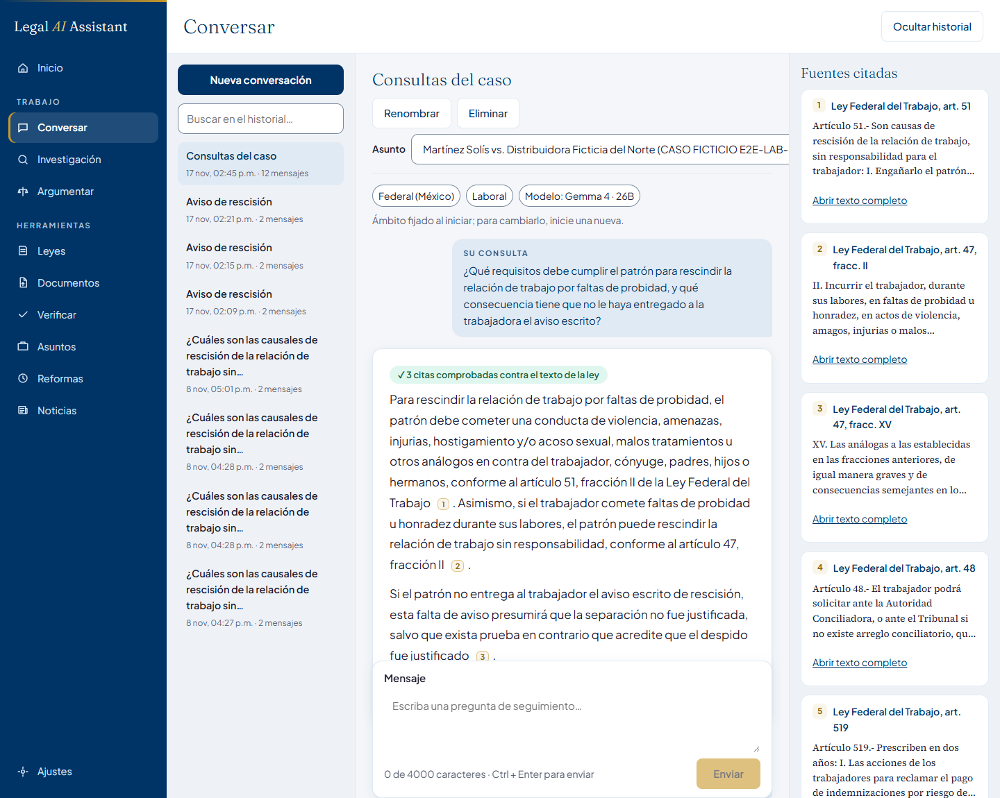

*Every screenshot in this README comes from the running app with sample data: the fictional labor
case E2E-LAB-01 ([docs/EVALUACION-E2E.md](docs/EVALUACION-E2E.md)) under the Mexican Ley Federal del
Trabajo. The interface is shown in Spanish (es-MX); English (en-US) is one click away in "Ajustes".
Each numbered citation opens the source with the cited passage highlighted.*

## Contents

[The contract](#the-contract) · [A tour of the app](#a-tour-of-the-app) · [What is loaded](#what-is-loaded) ·
[Architecture](#architecture) · [Measured results](#measured-results) · [Run it](#run-it) · [Tests](#tests) ·
[Documentation](#documentation) · [Repository map](#repository-map) · [Known limits](#known-limits)

## The contract

| Rule | How it is enforced |
|---|---|
| A legal claim needs a citation to a retrieved fragment | A validator parses every `[cite: ID]` and rejects ids that were not shown to the model in this query. One regeneration, then refusal. |
| Quoted statute text must be verbatim | Quotations are compared with the cited fragment after folding accents, case and whitespace. |
| No answer without evidence | A calibrated threshold on the rerank score refuses before any model call. |
| The model never verifies itself | Refusal text, citation existence, quotation checks and coverage are code. |
| One firm never sees another firm's data | Row-level security with `FORCE`, fail-closed policies, and a test that seeds two firms with overlapping content. |
| A jurisdiction never leaks into another | A SQL pre-filter built in one function from a closed catalog. Selecting a municipality adds its state and the federation, never a sibling. |

## A tour of the app

The side rail has three workspaces (**Conversar**, **Investigación**, **Argumentar**) and six tools
(**Leyes**, **Documentos**, **Verificar**, **Asuntos**, **Reformas**, **Noticias**). The design rules
are in [docs/Brand.md](docs/Brand.md).

### Start page

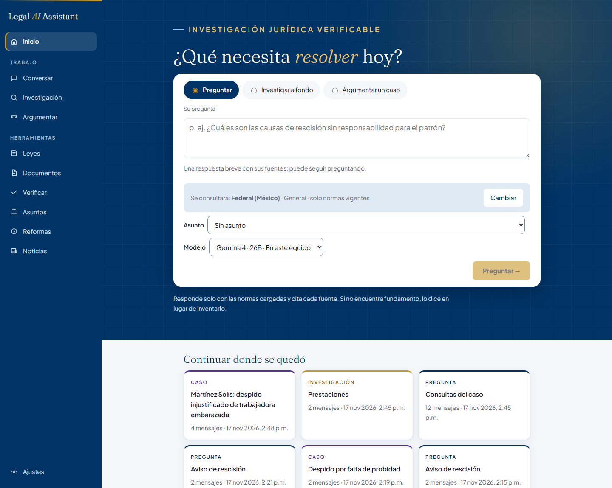

One box with three modes: **Preguntar** (a short answer with sources, follow-ups allowed),
**Investigar a fondo** (a research file) and **Argumentar un caso** (sparring). Under the box, the
scope is stated in one line before anything is sent ("Federal (México) · General · solo normas
vigentes"). "Cambiar" unfolds the jurisdiction, profile and vigencia selectors, which come from a
closed catalog, never from free text. The user can keep the work inside a matter and choose the
model for that conversation. "Continuar donde se quedó" lists recent work, and a banner appears when
an amendment touches something the user already cited.

### Conversar

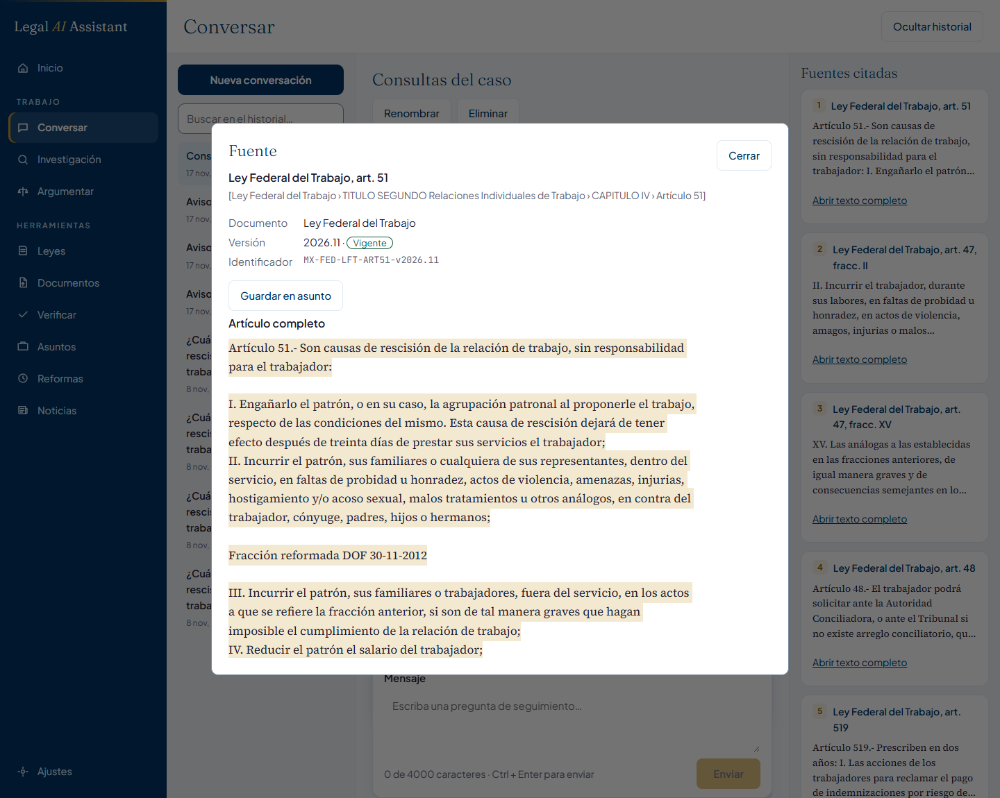

Questions with follow-ups, kept in a history on the left. An answer shows how many of its
citations were checked against the statute text ("3 citas comprobadas contra el texto de la ley"),
and the sources panel on the right lists every cited unit. "Abrir texto completo" or a numbered
mark opens the source dialog above: the breadcrumb, the document, the version and whether it is in
force, the stable identifier (`MX-FED-LFT-ART51-v2026.11`), and the full article with the cited
passage highlighted. "Guardar en asunto" files it in a matter.

Rules that shape it: every message is searched as written, and earlier citations are carried forward
only into the remaining context budget (ADR-009, ADR-016). Jurisdiction, profile and model are fixed
when the conversation starts; changing them is a new conversation, never an inference.

### Investigación

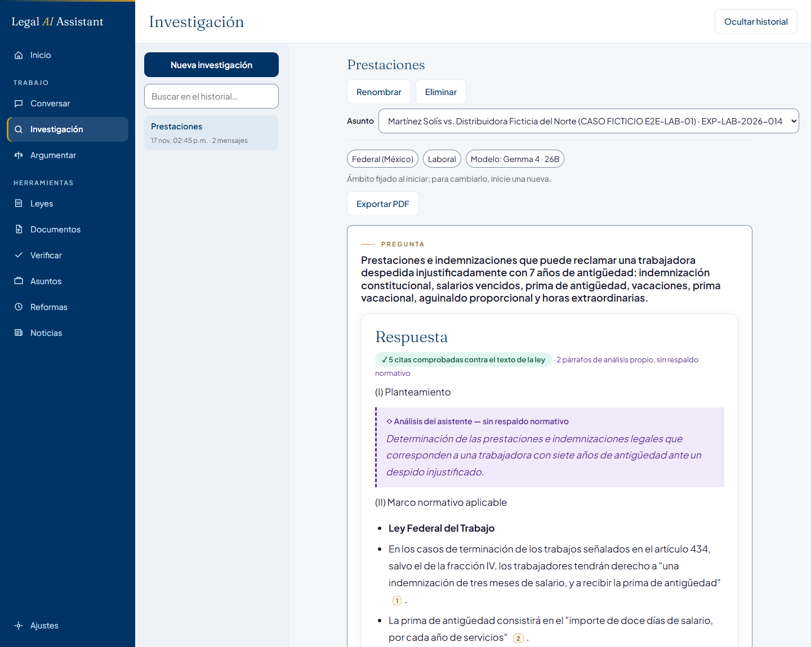

A structured research file for a question: *Planteamiento*, *Marco normativo*, *Criterios*,
*Análisis* and *Fuentes citadas*, exportable to PDF. Sentences the model adds that the sources do not
support are not hidden and are not styled as citations: they appear in a purple block, "Análisis del
asistente — sin respaldo normativo", and the header counts them next to the verified citations.

### Argumentar

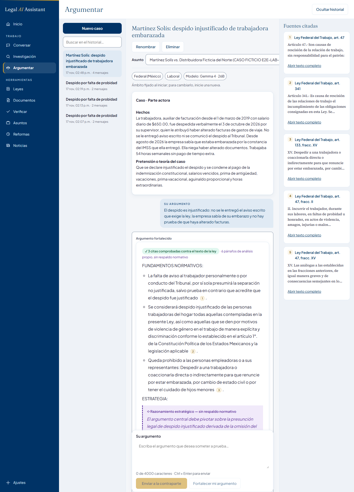

Sparring against opposing counsel. A case holds the facts, the side the user represents (a closed
list: actora, demandada, defensa, acusación, tercero interesado) and the claim. Each round, the user
writes an argument and chooses **Enviar a la contraparte** (the opposing counsel's attack) or
**Fortalecer mi argumento** (the same argument reinforced with the sources). The screenshot shows a
strengthened round: three citations checked against the text, and the strategy section set apart in
purple as reasoning without normative support. Legal assertions need a citation; strategic reasoning must
be marked `[razonamiento estratégico]`, and an unmarked uncited sentence fails validation (ADR-016,
ADR-021).

### Leyes

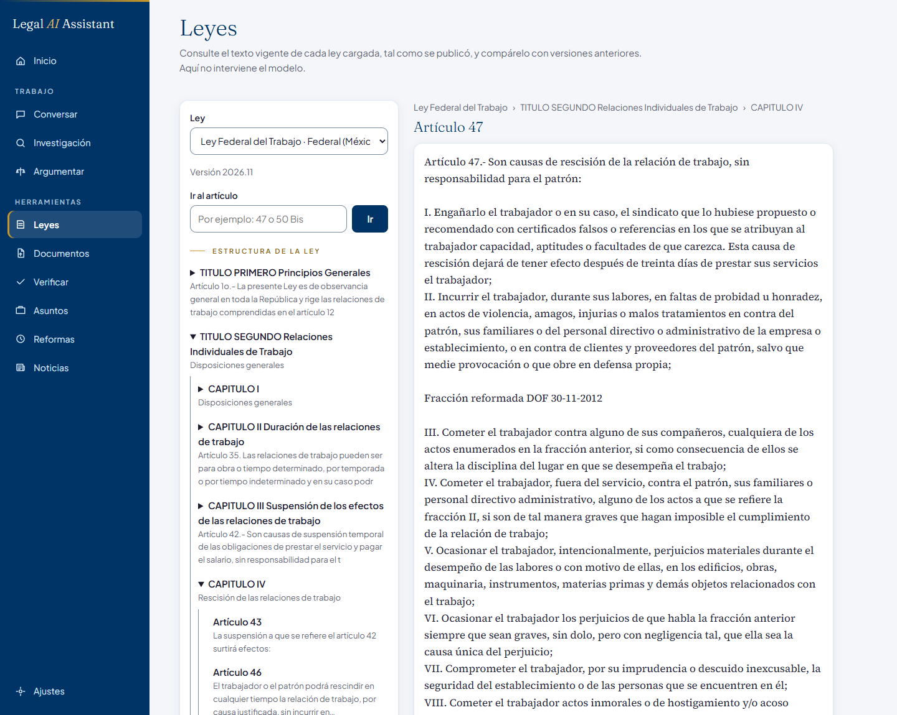

Browse each loaded law by its structure (título, capítulo, artículo), jump to an article by number,
and read it as published. Versions can be compared: what an amendment added and removed is marked
with text, not colour alone. The model is not involved; browsing a law is an explicit choice of that
law and never widens a conversation's scope.

### Verificar

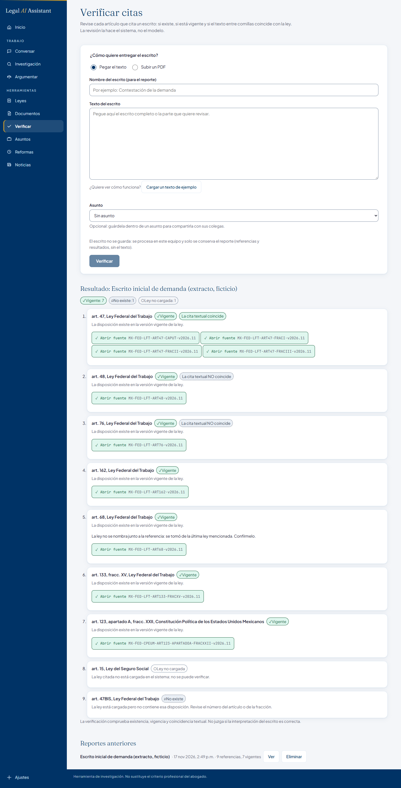

Paste a brief or upload a PDF and get one finding per citation: does the article exist, is it in
force (*Vigente* / *No vigente* / *Ley no cargada*), and does the quoted text match the law verbatim
(*La cita textual coincide* / *NO coincide*). A law taken from context instead of being named next to
the reference is flagged for the lawyer to confirm. The checks are code, with no model judge. The
brief is processed in memory and **not stored**: only the report is kept, with references and
statuses but not the brief's text (ADR-019). The page above is the stored report of the E2E case's
complaint, which has errors seeded on purpose.

### Asuntos (matters)

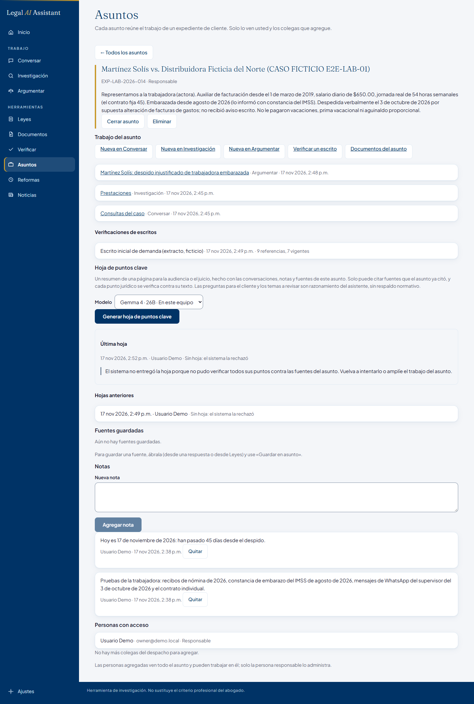

A matter gathers the work of one client file: conversations from the three workspaces, verified
briefs, the firm's documents, saved sources and notes. It is visible only to its owner and the
members the owner adds from the firm, and that rule is enforced in the database by row-level security,
not only in the interface (ADR-018). Starting a conversation from the matter's links keeps it inside
the matter.

**Hoja de puntos clave (key-points sheet).** From the matter's page the model writes a one-page sheet
for a hearing or trial, with four sections: *Puntos clave*, *Riesgos*, *Preguntas para el cliente* and
*Temas a revisar*. `/asuntos/hoja` prints it on one letter page ("Guardar como PDF"). It is verified like
an answer: it can cite only sources the matter already cited, every legal point is checked against its
text, and the questions for the client and the topics to review are marked as the assistant's own
reasoning, without normative support. If a point cannot be verified, the system refuses instead of
delivering a sheet, as in the screenshot above ("Sin hoja: el sistema la rechazó"). That is the
contract working, and it also means the sheet is refused often with the local model (ADR-028). No
screenshot of a delivered sheet is included for that reason.

### Documentos (the firm's own documents)

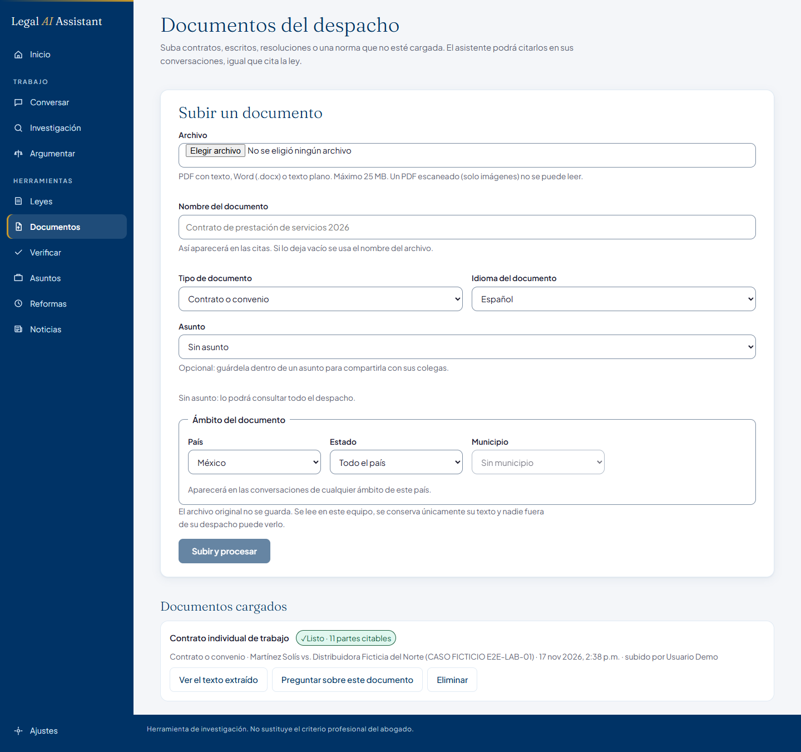

Upload a contract, a brief, a ruling or a law that is not loaded (PDF with a text layer, Word or
plain text, up to 25 MB) and it becomes citable like any statute. The original file is never stored:
it is read in memory and only its text is kept, split into citable parts ("Listo · 11 partes
citables"). A document filed under a matter is invisible to colleagues outside it. It is filed under
a jurisdiction from the same closed catalog, and "Preguntar sobre este documento" opens a
conversation in its matter (ADR-025).

### Reformas

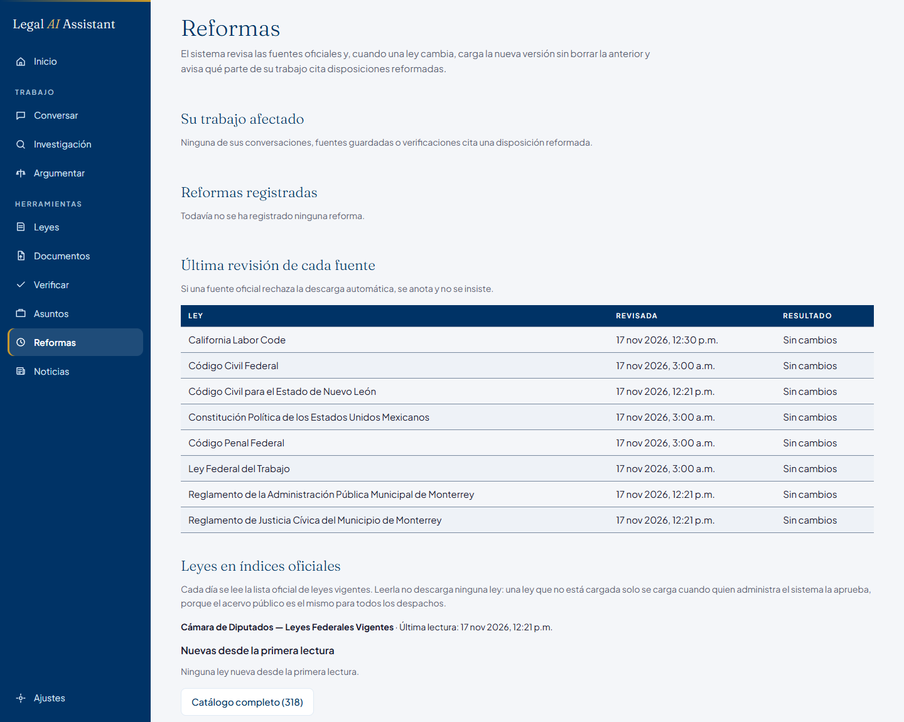

A scheduled job reads the official sources, loads a changed law as a **new version** (the old one is
kept, never deleted) and records what changed per citable unit. This page shows the user's work that
cites amended text, the registered reforms and the last check of every source, including a source
that refused the automatic download (it is noted and never evaded). A second section lists
laws found in official indexes that are not loaded yet; loading one is an operator decision
(ADR-017, ADR-026). A read-only canary on GitHub checks every source daily (ADR-029).

### Noticias

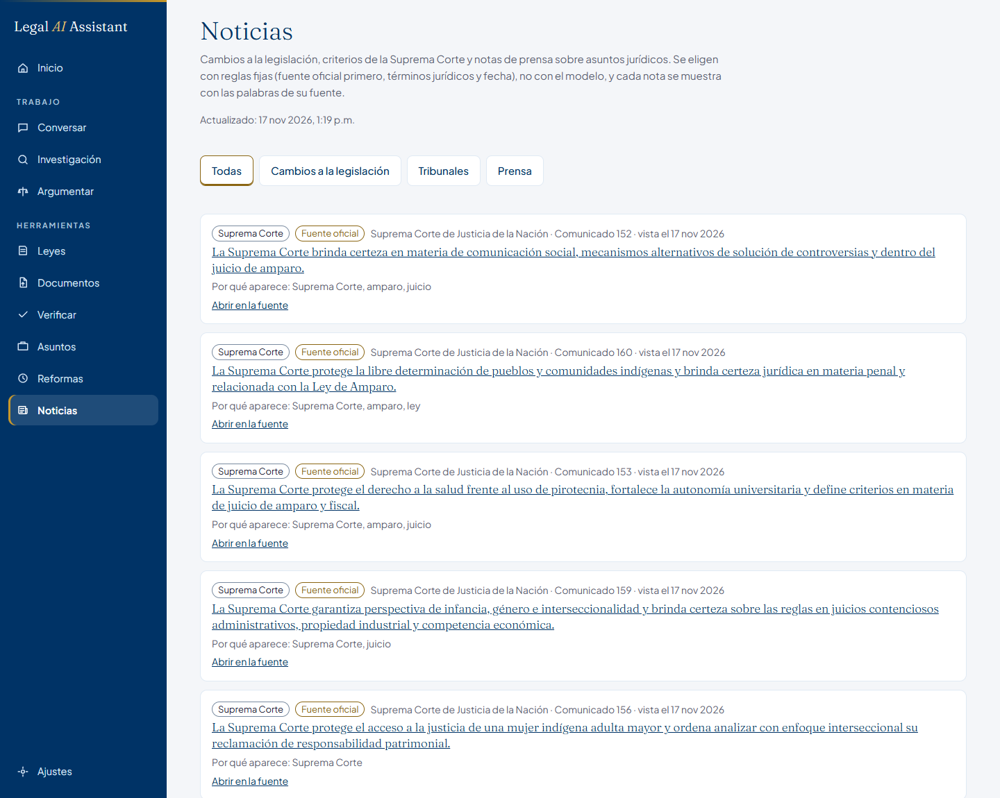

A feed of up to 30 items about legislative changes, Supreme Court releases and press notes. Items are
chosen by fixed rules (official source first, legal terms from a closed catalog, recency), not by the
model, and each one is shown in its source's own words with a "Por qué aparece" line and a link to
the source. Press is labelled as press and is never a source of an answer (ADR-027).

### Dark theme and phone

<table>
  <tr>
    <td>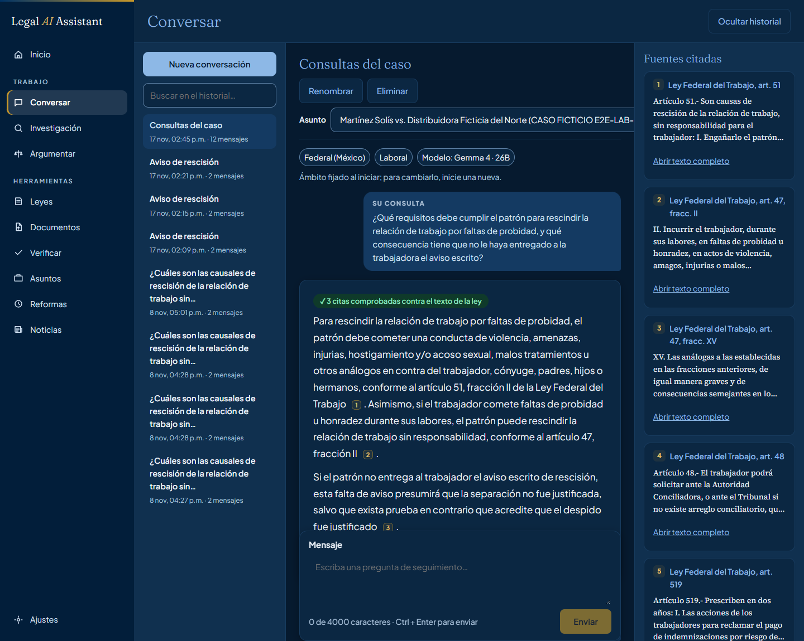</td>
    <td width="260">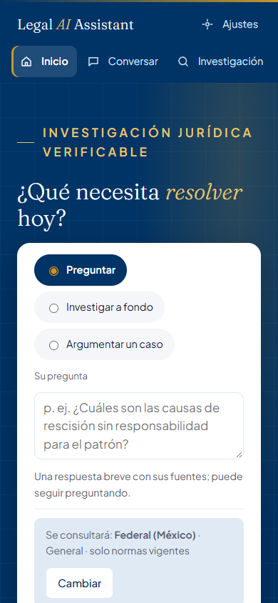</td>
  </tr>
</table>

Light and dark themes, and a layout that works at phone width. The browser checks (accessibility with
axe in both themes, keyboard operation, content security policy, es-MX and en-US) run in CI.

## What is loaded

The demo corpus is statutes, about 18,400 current retrieval units in eight laws, each loaded with its
legal structure and an official route for updates:

| Jurisdiction | Laws |
|---|---|
| Mexico, federal | Constitución Política de los Estados Unidos Mexicanos, Ley Federal del Trabajo, Código Civil Federal, Código Penal Federal |
| Mexico, Nuevo León (state) | Código Civil para el Estado de Nuevo León |
| Mexico, Monterrey (municipal) | Reglamento de la Administración Pública Municipal, Reglamento de Justicia Cívica |
| United States, California | Labor Code |

Selecting Monterrey searches Monterrey, Nuevo León and the federation, and nothing from any other
state ([.claude/rules/jurisdictions.md](.claude/rules/jurisdictions.md)). Case law is not loaded.

## Architecture

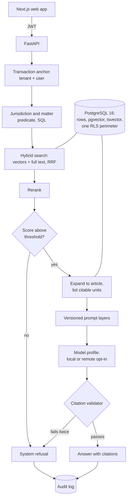

The order is fixed: the predicate runs before vector search, the validator after generation.

| Decision | Reason | Record |
|---|---|---|
| One PostgreSQL holds rows, vectors and full text | A second store is a second isolation boundary to keep in sync | ADR-001 |
| Chunks follow legal structure, not token windows | The citation unit (fracción) and the context unit (article) are different on purpose | `rules/rag.md` |
| Hybrid search | "art. 123 apartado B" is a lexical signal that embeddings blur | ADR-022 |
| Refusal is a system action | Asked to decline in its own words, a model explains and then answers anyway | ADR-007 |
| The demo is fully local | Privileged material does not leave the machine | ADR-014 |
| Strict citation coverage | An uncited legal sentence does not reach the user, at the cost of some refusals | ADR-015 |
| The model is chosen per conversation from a closed catalog | Gemma (default) and Qwen run locally; Claude is remote and a firm opt-in | ADR-024 |

All 29 decisions, with the options considered and the measurements behind them, are in
[.claude/rules/architecture.md](.claude/rules/architecture.md). The full design is in
[docs/LegalAI-System-Architecture.md](docs/LegalAI-System-Architecture.md), which opens with
a table of where the build departs from it.

## Measured results

Golden suite, 25 cases, local models. The run records are in `evals/runs/`.

| Metric | Gemma 4 26B (default) | Qwen 3 4B |
|---|---|---|
| Recall@8 | 1.00 | 1.00 |
| Jurisdiction leakage | 0 | 0 |
| Citation precision | 1.00 | 1.00 (3 answers) |
| Correct refusals | 5 of 5 | 5 of 5 |
| False refusals | 1 of 20 | 17 of 20 |
| Median time per answer | 35 s | 19 s |

Read these with their limits:

- **The cases were drafted with AI and no lawyer has reviewed them.** Until that review, no
  release gate counts. A set written from the corpus inherits its vocabulary and overstates
  performance.
- **One case moves a rate by 4 to 5 points.** Differences of one or two cases are noise.
- **Citation precision is 1.00 by construction** (the validator rejects everything else). It
  proves provenance, not that a paraphrase is faithful. That check is still human.
- The remote Claude profile has not been measured.

**End-to-end case for lawyer review** ([docs/EVALUACION-E2E.md](docs/EVALUACION-E2E.md)). A fictional
labor case under Mexican law (a pregnant worker dismissed verbally, without written notice) run through
every tool with the local model, then packaged for a practising lawyer to grade each answer against the
full text of every cited article. First run, 2026-11-17: 8 of 9 answers delivered; the brief verifier
caught every seeded error and one the team made by accident; the key-points sheet was refused (the
model cited units it was not shown). Reading the answers showed several citations to real articles that
do not apply to the case (for example a two-year limitation period where the law gives two months).
The validator cannot catch these: it proves provenance, not legal fit. The lawyer's review is pending.

Two changes worth reading as examples of the method:

- **ADR-022.** Explicit references are resolved by a citation grammar instead of ranked.
  Recall@8 went from 0.90 to 1.00 with no case worse. Two plausible alternatives were measured
  and rejected.
- **ADR-023.** Found by reading a review sheet, not by a metric: an answer cited the right id
  and paraphrased the neighbouring section. The context unit became the apartado.

## Run it

Requirements: Docker, [uv](https://docs.astral.sh/uv/), Node 22 and
[Ollama](https://ollama.com) with `bge-m3`, `gemma4:26b-a4b-it-qat` and
`qwen3:4b-instruct-2507-q4_K_M`.

On Windows, one command installs what is missing (it asks first), migrates, seeds the
corpus, creates a demo user and opens the app:

```powershell
powershell -ExecutionPolicy Bypass -File scripts\dev-up.ps1
```

By hand, on any system:

```bash
docker compose up -d postgres redis
uv sync
uv run alembic upgrade head
uv run python -m app.ingestion.seed        # about 9 minutes on CPU
uv run python -m app.demo                  # prints the demo password once
uv run uvicorn app.main:app --host 127.0.0.1 --port 8000
cd web && npm install && npm run build && npx next start -H 127.0.0.1 -p 3100
```

Everything binds to `127.0.0.1`. Details and troubleshooting:
[docs/LOCAL_DEMO.md](docs/LOCAL_DEMO.md) (Spanish).

**Regenerate the screenshots** with the app running and the demo account created:
`cd web && node e2e/readme-shots.mjs ../docs/img` (it reads `.demo-credentials`, which is never committed,
and makes no model call).

## Tests

```bash
uv run pytest                                  # needs Postgres; an unreachable database fails, never skips
uv run pytest tests/test_tenant_isolation.py   # the cross-tenant leak test
uv run ruff check && uv run mypy app
uv run python -m app.doctor                    # invariants as checks: roles, RLS, extensions, pinned models
uv run python -m evals.run --suite golden      # required before any prompt, chunker or retrieval change
cd web && npm test && npx tsc --noEmit
```

Tests run with network sockets disabled except loopback; the model, embedder and reranker
are fakes. Row-level security is tested against a real PostgreSQL built by the real
migrations, with the production roles. CI ([.github/workflows/ci.yml](.github/workflows/ci.yml)) runs
lint, types, the whole backend suite on a real PostgreSQL, the web guards, a production build and the
browser checks on every pull request. A daily read-only canary
([.github/workflows/etl-canary.yml](.github/workflows/etl-canary.yml)) checks every official and news source.

## Documentation

| Document | Language | What it is |
|---|---|---|
| [docs/PITCH.md](docs/PITCH.md) | es | The problem, the solution, why it can be trusted, the engineering spec and the current state |
| [docs/LegalAI-System-Architecture.md](docs/LegalAI-System-Architecture.md) | en | The full design blueprint: data model, multi-tenancy, retrieval, prompts, validation. Opens with where the build departs from it |
| [.claude/rules/architecture.md](.claude/rules/architecture.md) | en | Component map and the append-only log of the 29 architecture decisions (ADR) |
| [.claude/CLAUDE.md](.claude/CLAUDE.md) | en | The non-negotiable invariants, every command, and the per-session workflow |
| [.claude/rules/rag.md](.claude/rules/rag.md) | en | Chunker rules, retrieval defaults, and the citation validator specification |
| [.claude/rules/multi-tenancy.md](.claude/rules/multi-tenancy.md) | en | Row-level-security policies, roles, anchors and the tenant isolation test |
| [.claude/rules/jurisdictions.md](.claude/rules/jurisdictions.md) | en | Jurisdiction catalog semantics and the predicate builder contract |
| [.claude/rules/prompts.md](.claude/rules/prompts.md) | en | Prompt layers, versioning, pinning and injection rules |
| [.claude/rules/style.md](.claude/rules/style.md) | en | Code, test and i18n conventions |
| [docs/PLAN.md](docs/PLAN.md) | es | Workstreams and tasks from zero to demo, with a dated log of what was done |
| [docs/EVALUACION-E2E.md](docs/EVALUACION-E2E.md) | es | The end-to-end labor case and how a lawyer reviews it |
| [evals/e2e/README.md](evals/e2e/README.md) | es | How to run an end-to-end case and build the review packet |
| [evals/golden/README.md](evals/golden/README.md) | en | The golden set: schema, status and commands |
| [docs/LOCAL_DEMO.md](docs/LOCAL_DEMO.md) | es | Running the demo on one machine, with troubleshooting |
| [docs/Brand.md](docs/Brand.md) | es | The source of truth for the interface: colour, type, components, screens |
| [docs/ROADMAP.md](docs/ROADMAP.md) | es | Future work in three horizons, and the anti-roadmap of what will not be built |
| [docs/lessons-from-library-rag.md](docs/lessons-from-library-rag.md) | es | Lessons imported from the sibling project, and what was deliberately not imported |
| [.claude/skills/](.claude/skills/) | en | Working procedures: eval runner, prompt lab, decision records, legal chunking |
| [LICENSE](LICENSE) | en | Proprietary, all rights reserved |

## Repository map

| Path | Contents |
|---|---|
| `app/api/` | Thin FastAPI routers: auth, session validation, delegation |
| `app/rag/` | Jurisdiction predicate, hybrid search, fusion, gate, context assembly |
| `app/validation/` | Citation parser, verbatim and coverage checks, regeneration loop |
| `app/prompts/` | Versioned prompt layers, pinned by hash |
| `app/ingestion/` | Legal-structure grammars, chunker, reform watcher, firm documents, source canary |
| `app/news/` | The legal news feed: sources, fixed-rule scoring, pipeline |
| `app/chat/` | The conversation turn (retrieve, generate, validate) and the key-points sheet |
| `app/corpus/` | Reading the corpus without a model: reform lineage and the brief verifier's grammar |
| `app/db/` | Models, RLS policy templates, migrations |
| `app/orchestration/` | Model profiles, pinned model ids, clients |
| `evals/` | Golden suite, threshold calibration, review sheets, end-to-end cases, run records |
| `web/` | Next.js app, unit guards, browser tests and the screenshot script |
| `docs/` | Design, plan, roadmap, brand rules, screenshots (`docs/img/`) |

## Known limits

- Scanned PDFs are not read (no OCR).
- Case law is not loaded; the corpus is statutes.
- An answer takes 1.5 to 4 minutes with the local 26B model on an 8 GB GPU.
- The refusal threshold was calibrated on statute text with AI-drafted probe sets; a question about a
  firm's own contract fell just under it in the end-to-end case.
- A citation can be real and verified yet point to an article that does not govern the case. Only a
  lawyer's review catches that today ([docs/EVALUACION-E2E.md](docs/EVALUACION-E2E.md)).
- The key-points sheet is refused some of the time: it only delivers when every point verifies against
  the matter's sources.
- Designed but not built: Celery workers, a deployed LiteLLM proxy, tracing, an NLI judge.

This is a research tool for lawyers. It does not replace professional judgment.

## Author

Octavio Pérez Bravo, Data & AI Strategy Architect.

## License

Proprietary, all rights reserved ([LICENSE](LICENSE)). Any use of the application and any copy of the
code, in whole or in part, needs the author's prior written approval. The software is provided as is,
without warranty, and its output is not legal advice.
